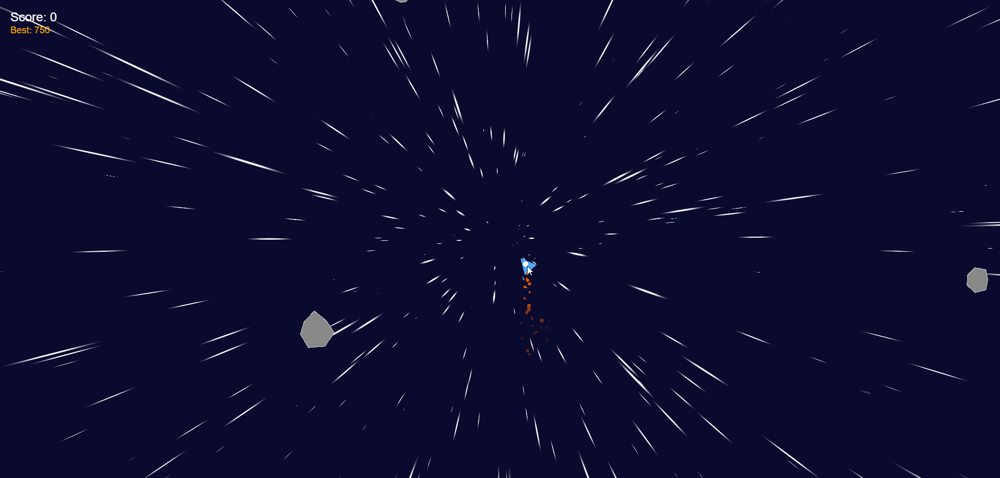
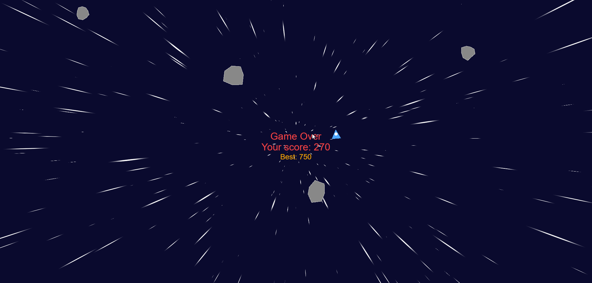
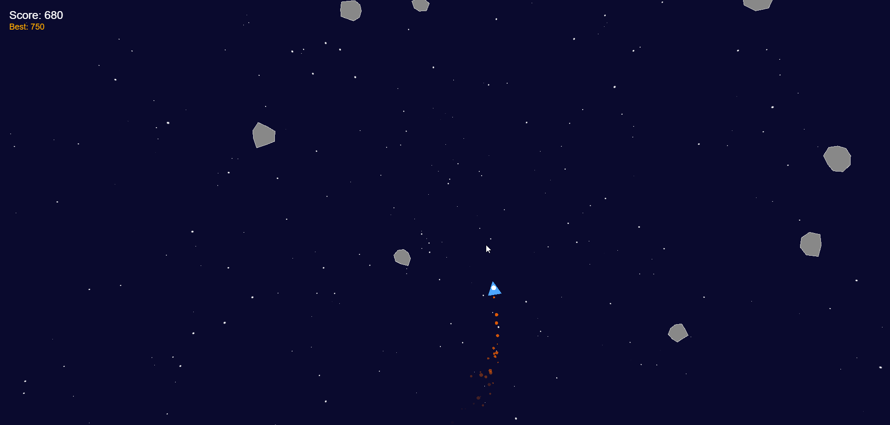

# 🚀 CosmoDodge

Веб-игра, разработанная на **PixiJS**, в которой игроку необходимо управлять объектом и уклоняться от препятствий в космическом пространстве. 

Этот pet-проект создан для демонстрации навыков работы с 2D-рендерингом в браузере, динамической генерацией игровых объектов и отслеживанием статистики в реальном времени.

## ✨ Ключевые особенности

- **Динамическая генерация:** Препятствия и игровые элементы создаются процедурно, что обеспечивает высокую реиграбельность.
- **Игровая статистика:** Реализована система подсчета очков, отслеживания рекордов и отображения текущих метрик игры на экране.
- **Оптимизированный рендеринг:** Использование возможностей PixiJS для плавной анимации (60 FPS) и эффективного управления спрайтами.
- **Чистая архитектура:** Логика игры разделена на модули (управление состоянием, рендеринг, обработка ввода) для удобства поддержки и расширения.

## 🛠 Стек технологий

- **JavaScript (ES6+)** — основная логика игры
- **PixiJS** — высокопроизводительный 2D-рендеринг
- **HTML5 / CSS3** — разметка и стилизация контейнера игры

## 🎮 Управление

- **Стрелки** или **WASD** — перемещение игрока.
- *(Если есть другие клавиши, например, пробел для паузы или перезапуска, добавь их сюда)*

## 🚀 Как запустить проект локально

1. Клонируйте репозиторий:
   ```bash
   git clone https://github.com/KCheremisina/cosmododge.git
2. Перейдите в папку проекта:
   ```bash
    cd cosmododge
3. откройте терминал и выполните:
   ```bash
    npm run dev
4. Перейдите по ссылке Local

## 📸 Скриншоты


